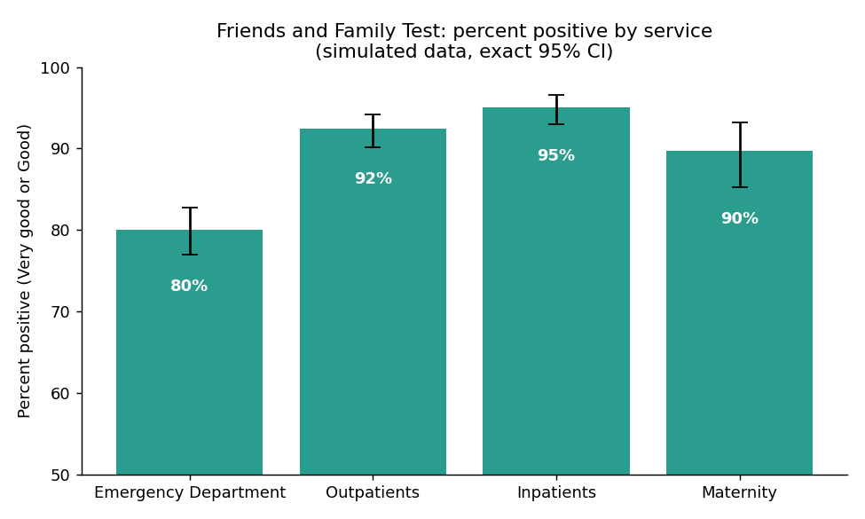
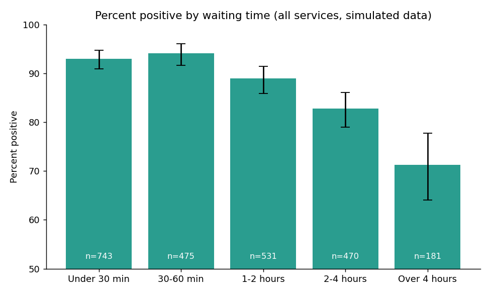
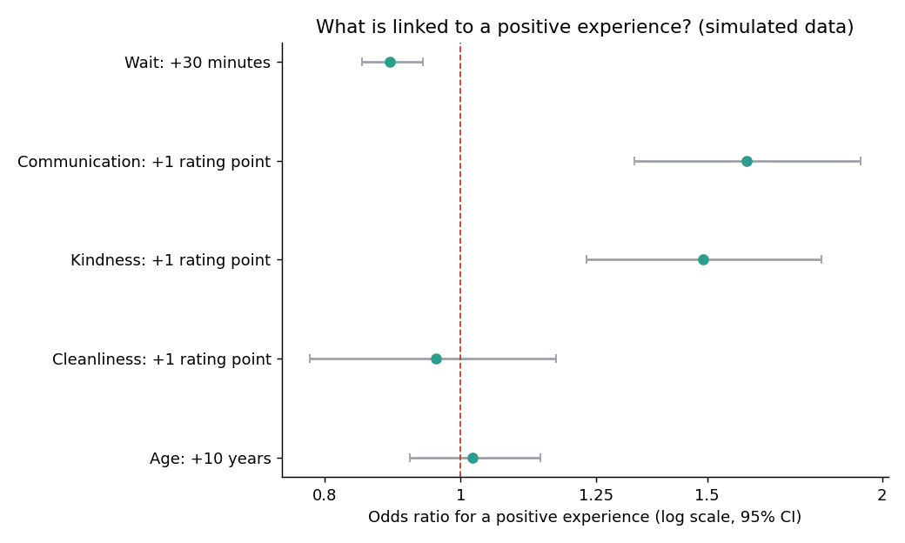
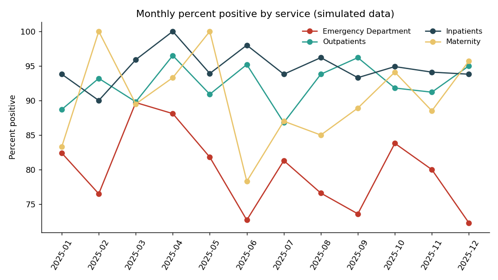

# Patient Experience Dashboard: NHS-Style Friends and Family Test Analysis

> **Important note on data:** This project uses **simulated data**. It contains no patient or hospital data. The 2,400 survey responses were generated to resemble NHS Friends and Family Test (FFT) results, with positive scores set close to figures published by an NHS trust (see Data sources). How waiting time, communication, kindness, and cleanliness affect the rating is an **assumption**, not a published effect size. The results show how the analysis works, not what any real hospital achieves.

**Live dashboard:** [Open the interactive dashboard](https://patient-satisfaction-dashboard-9tk3fmyv7wdcfbpbeqdbapp.streamlit.app/)

## Question
How satisfied are patients across four hospital services, and which factors (waiting time, communication, staff kindness, cleanliness) are linked to a positive experience?

## The Friends and Family Test method
NHS services ask one question: "Overall, how was your experience of our service?" with answers from Very good to Very poor. **Percent positive** is the share answering Very good or Good, out of all responses including "Don't know". This project follows the same method.

## Dataset (simulated)
| | |
|---|---|
| Responses | 2,400 across 2025 |
| Services | Emergency Department, Outpatients, Inpatients, Maternity |
| Fields | Date, service, age, sex, waiting time (minutes), communication, kindness and cleanliness ratings (1 to 5), overall experience |

## Key results
Percent positive with exact 95% confidence intervals:

| Service | Responses | Percent positive | Percent negative |
|---|---|---|---|
| All services | 2,400 | 88.7 (87.3 to 89.9) | 3.2 |
| Emergency Department | 795 | 80.0 (77.0 to 82.7) | 6.4 |
| Outpatients | 747 | 92.4 (90.2 to 94.2) | 1.5 |
| Inpatients | 605 | 95.0 (93.0 to 96.6) | 1.2 |
| Maternity | 253 | 89.7 (85.3 to 93.2) | 3.6 |



**Waiting time:** percent positive falls from about 93% for waits under 30 minutes to 82.8% for 2 to 4 hours and 71.3% (95% CI 64.1 to 77.7) for waits over 4 hours.



**What is linked to a positive experience** (logistic regression, adjusted for service and age):

| Factor | Odds ratio (95% CI) |
|---|---|
| Wait, each extra 30 minutes | 0.89 (0.85 to 0.94) |
| Communication, each rating point | 1.60 (1.33 to 1.93) |
| Kindness, each rating point | 1.49 (1.23 to 1.81) |
| Cleanliness, each rating point | 0.96 (0.78 to 1.17), not significant |
| Age, each 10 years | 1.02 (0.92 to 1.14), not significant |



**Winter pressure in the Emergency Department:** waits were set longer in December to February (median 194 vs 156 minutes), and the share of positive responses was lower (77.2% vs 80.9%), but this difference is **not statistically significant** (Fisher's exact test, p = 0.29).



## Conclusion and limitations
In this simulated survey, the Emergency Department had the lowest percent positive, and longer waits, weaker communication, and less kindness were each linked to lower odds of a positive rating. **These links are built into the simulation by design**, so they demonstrate the method (FFT scoring, exact confidence intervals, logistic regression, and an interactive dashboard) and not a real finding. One detail worth noting: cleanliness was given a small assumed effect, yet the analysis could not detect it, which shows how small effects can be missed even with 2,400 responses.

Other limits: only associations are shown, ratings from the same patient are assumed independent, and a real analysis would also use free-text comments, response rates, and non-response checks.

## Dashboard
`app.py` is a Streamlit dashboard with service and month filters, headline KPIs, a monthly trend, the rating distribution, waiting-time bands, and a comparison of staff ratings. Run it with:
```bash
pip install -r requirements.txt
streamlit run app.py
```

## Data sources and how the simulated numbers were chosen
| Item | Value used | Source |
|---|---|---|
| FFT question and answer scale | Very good to Very poor; positive = Very good or Good | [Epsom and St Helier University Hospitals, patient experience page](https://epsom-sthelier.nhs.uk/patient-experience) |
| Inpatients positive score | 95.3% (September 2021) | [East Lancashire Hospitals NHS Trust, FFT results](https://elht.nhs.uk/download_file/3912/3263) |
| Emergency Department positive score | 66.1% (September 2021), 82.3% (February), 86.8% (April) | East Lancashire Hospitals NHS Trust, FFT results ([September](https://elht.nhs.uk/download_file/3912/3263), [February](https://elht.nhs.uk/download_file/3304/3263), [April](https://elht.nhs.uk/download_file/3710/3263)) |
| Outpatients positive score | 93.4% (February) | [East Lancashire Hospitals NHS Trust, FFT results](https://elht.nhs.uk/download_file/3304/3263) |
| Maternity positive score | 86.0% (December) | [East Lancashire Hospitals NHS Trust, FFT results](https://elht.nhs.uk/download_file/3212/3057) |

**Targets used:** Emergency Department 80%, Outpatients 93%, Inpatients 95%, Maternity 90%. **Assumptions:** the effect of waiting time, communication, kindness and cleanliness on the rating, and longer emergency waits in winter. All constants are at the top of `generate_data.py`.

## How to reproduce
```bash
pip install -r requirements.txt
python generate_data.py     # creates data/patient_survey.csv
python analysis.py          # results tables and charts
streamlit run app.py        # interactive dashboard
```

## Repository structure
```
Patient-Satisfaction-Dashboard/
├── generate_data.py
├── analysis.py
├── app.py
├── requirements.txt
├── data/
│   └── patient_survey.csv
├── images/               # charts used in this README
└── README.md
```
`analysis.py` also writes result tables to a `results/` folder when it runs.

## Author
**Yosra El Nagar**, Cath Lab Head Nurse moving into Healthcare Data Analytics
[LinkedIn](https://www.linkedin.com/in/yosra-nagar-9a6862118/) | [GitHub](https://github.com/yosras-dotcomAi)
